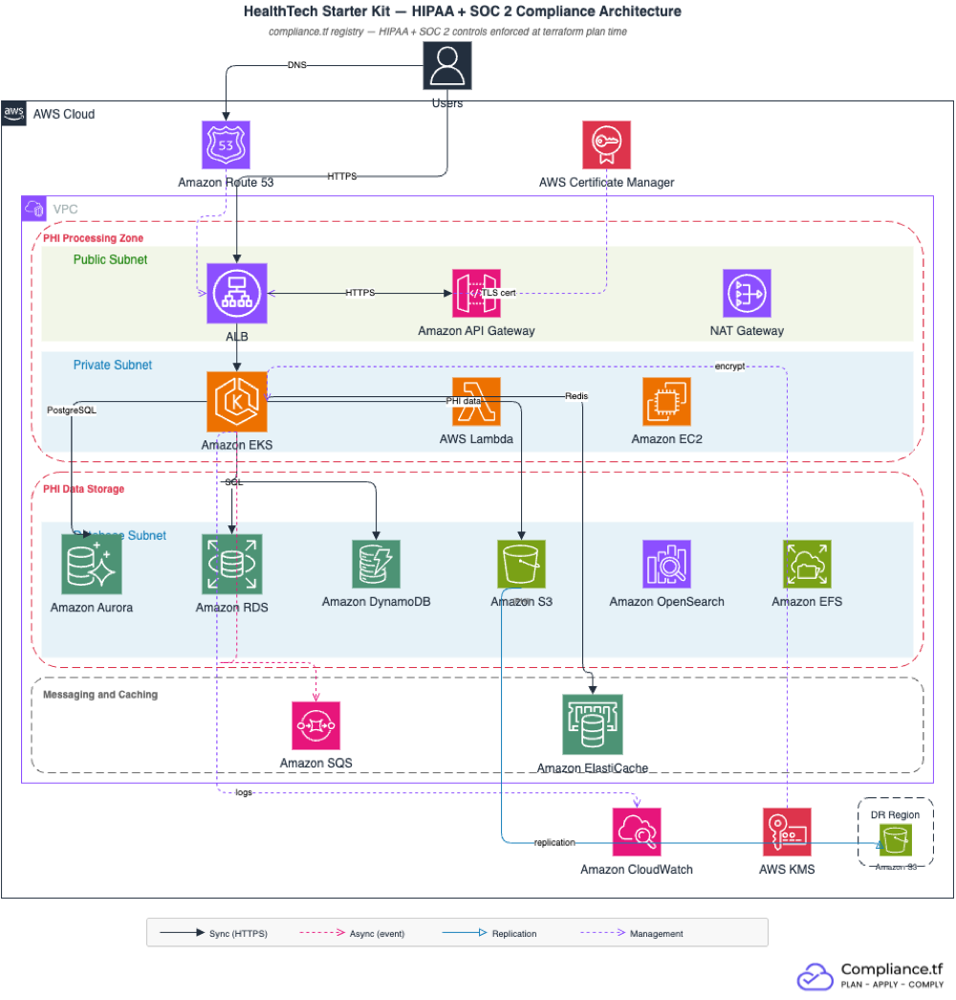

# HealthTech Starter Kit - HIPAA

Terraform configuration that deploys HIPAA-compliant AWS infrastructure for healthtech companies. Modules are sourced from the [compliance.tf registry](https://hipaa.compliance.tf), which validates HIPAA Security Rule controls at `terraform plan` time — non-compliant configurations fail before they can be applied.

## Architecture



## Prerequisites

- Terraform >= 1.3
- AWS credentials configured (`aws configure` or environment variables)
- A compliance.tf access token ([sign up](https://compliance.tf) or [start a free trial](https://compliance.tf/free-trial/))
- A Route 53 hosted zone for your domain (used for ACM DNS validation)
- **S3 cross-region replication resources** (HIPAA 164.308(a)(7)(ii)(A) requires a retrievable data backup plan):
  - An IAM role ARN authorized for S3 replication (`s3_replication_role_arn`)
  - A destination S3 bucket in your DR region (`s3_replication_destination_bucket_arn`)

> **HIPAA Critical:** RDS encryption (`storage_encrypted = true`) must be enabled at database creation. It cannot be added to an existing unencrypted RDS instance without rebuilding it. This kit enforces encryption by default. Do not disable it.

## Quick Start

```bash
# 1. Clone the repo
git clone https://github.com/compliancetf/starter-kit-healthtech-hipaa.git
cd starter-kit-healthtech-hipaa

# 2. Copy the example tfvars and fill in your values
cp terraform.tfvars.example terraform.tfvars
# Edit terraform.tfvars - set at minimum:
#   project_name, domain_name, route53_zone_id,
#   availability_zones (must match aws_region),
#   s3_replication_role_arn, s3_replication_destination_bucket_arn

# 3. Authenticate with the compliance.tf registry
terraform login hipaa.compliance.tf

# 4. Initialize, plan, and apply
terraform init
terraform plan
terraform apply
```

`terraform plan` fails if any required HIPAA controls are not satisfied — the error message names the specific control and the module that violated it. A clean plan with the default configuration produces about 140 resources.

## Module Inventory

Every source below is a browsable page on the registry, with versions, inputs, and outputs - browse all modules at [hipaa.compliance.tf](https://hipaa.compliance.tf).

| Module | Source | Version | Purpose | Key HIPAA Requirements |
|--------|--------|---------|---------|------------------------|
| `vpc` | `hipaa.compliance.tf/terraform-aws-modules/vpc/aws` | `~> 6.0` | PHI network isolation, flow logs | 164.312(a)(1) (access control), 164.312(b) (audit controls) |
| `alb` | `hipaa.compliance.tf/terraform-aws-modules/alb/aws` | `~> 10.0` | HTTPS load balancing, access logs | 164.312(e)(1) (transmission security), 164.312(b) (access logs) |
| `apigateway` | `hipaa.compliance.tf/terraform-aws-modules/apigateway-v2/aws` | `~> 6.0` | API Gateway with PHI route access logging | 164.312(b) (audit controls) |
| `waf` | `hipaa.compliance.tf/terraform-aws-modules/wafv2/aws` | `~> 1.0` | Web Application Firewall | 164.312(e)(1) (guard against unauthorized access to ePHI in transit) |
| `acm` | `hipaa.compliance.tf/terraform-aws-modules/acm/aws` | `~> 6.0` | TLS certificate | 164.312(e)(1) (transmission security) |
| `kms` | `hipaa.compliance.tf/terraform-aws-modules/kms/aws` | `~> 4.0` | Customer-managed key wired to EKS, Lambda, RDS, EFS, and OpenSearch | 164.312(a)(2)(iv) (encryption and decryption) |
| `lambda` | `hipaa.compliance.tf/terraform-aws-modules/lambda/aws` | `~> 8.0` | VPC-attached PHI processing function | 164.312(a)(1) (restrict access to authorized programs) |
| `ec2_instance` | `hipaa.compliance.tf/terraform-aws-modules/ec2-instance/aws` | `~> 6.0` | Private worker nodes (IMDSv2, IAM instance profile) | 164.312(a)(1) (access control) |
| `eks` | `hipaa.compliance.tf/terraform-aws-modules/eks/aws` | `~> 21.0` | Kubernetes cluster (private endpoint, secrets encrypted) | 164.312(a)(2)(iv) (encryption), 164.312(b) (audit controls) |
| `rds` | `hipaa.compliance.tf/terraform-aws-modules/rds/aws` | `~> 7.0` | Standard RDS PostgreSQL (encrypted at creation) | 164.312(a)(2)(iv) (critical: encryption must be set at creation) |
| `rds_aurora` | `hipaa.compliance.tf/terraform-aws-modules/rds-aurora/aws` | `~> 10.0` | Aurora PostgreSQL (Multi-AZ, automated backups) | 164.312(c)(1) (integrity), 164.308(a)(7)(ii)(A) (data backup plan) |
| `dynamodb` | `hipaa.compliance.tf/terraform-aws-modules/dynamodb-table/aws` | `~> 5.0` | Key-value store (KMS, point-in-time recovery) | 164.312(a)(2)(iv) (encryption), 164.312(c)(1) (integrity) |
| `s3_bucket_phi` | `hipaa.compliance.tf/terraform-aws-modules/s3-bucket/aws` | `~> 5.0` | PHI storage (object lock, 7-year retention, cross-region replication) | 164.312(c)(1) (integrity), 164.308(a)(7)(ii)(A) (data backup plan) |
| `s3_bucket_logs` | `hipaa.compliance.tf/terraform-aws-modules/s3-bucket/aws` | `~> 5.0` | Audit log storage (versioning, cross-region replication, lifecycle per log_retention_days) | 164.312(b) (audit controls), 164.308(a)(7)(ii)(A) (data backup plan) |
| `efs` | `hipaa.compliance.tf/terraform-aws-modules/efs/aws` | `~> 2.0` | Encrypted file storage (CMK) | 164.312(a)(2)(iv) (encryption and decryption) |
| `sqs` | `hipaa.compliance.tf/terraform-aws-modules/sqs/aws` | `~> 5.0` | Message queue with dead-letter queue | 164.312(a)(2)(iv) (encryption) |
| `elasticache` | `hipaa.compliance.tf/terraform-aws-modules/elasticache/aws` | `~> 1.0` | Redis (encrypted, Redis AUTH) | 164.312(d) (person or entity authentication), 164.312(e)(1) (transmission security) |
| `opensearch` | `hipaa.compliance.tf/terraform-aws-modules/opensearch/aws` | `~> 2.0` | VPC-only search (CMK, HTTPS, audit logs) | 164.312(a)(1) (access control), 164.312(b) (audit controls) |
| `cloudwatch` | `hipaa.compliance.tf/terraform-aws-modules/cloudwatch/aws` | `~> 5.0` | Application log group (retention per log_retention_days) | 164.312(b) (audit controls) |

> **Two databases are provisioned:** This kit deploys both a standard RDS PostgreSQL instance and an Aurora PostgreSQL cluster. Aurora is the primary PHI store; the standard instance suits lower-tier data at a fraction of the cost (compare the two rows in the cost estimate below). Most teams need only one - delete the module block you do not use, plus its outputs (`rds_endpoint` for standard RDS; `aurora_cluster_endpoint` and `aurora_cluster_reader_endpoint` for Aurora). Neither module references the other.

> **CloudTrail is not in this kit:** 164.312(b) requires audit controls, and an auditor will expect the account-level CloudTrail alongside the resource-level logs this kit configures. CloudTrail is account-wide rather than module-level, so no module creates it - enable it separately.

## HIPAA Security Rule Coverage

| HIPAA Requirement | Description | Module(s) | What's Enforced |
|-------------------|-------------|-----------|-----------------|
| 164.312(a)(1) | Access Control | RDS, S3, EFS, OpenSearch, Lambda | IAM authentication, no public access, VPC isolation |
| 164.312(a)(2)(iv) | Encryption and Decryption | All data modules, KMS | KMS encryption at rest for all PHI data stores |
| 164.312(c)(1) | Integrity | S3, DynamoDB, RDS Aurora | Object lock, versioning, point-in-time recovery |
| 164.312(d) | Person or Entity Authentication | RDS, ElastiCache, OpenSearch | IAM auth, Redis AUTH, fine-grained access control |
| 164.312(e)(1) | Transmission Security | ALB, ElastiCache, OpenSearch | TLS 1.2+ enforced on all connections |
| 164.312(e)(2)(ii) | Encryption | All network modules | HTTPS/TLS required; chosen implementation of the addressable spec under 164.312(e)(1) |
| 164.308(a)(7)(ii)(A) | Data Backup Plan | RDS, RDS Aurora, S3 PHI | Automated backups, point-in-time recovery, cross-region replication |
| 164.312(b) | Audit Controls | All modules | VPC flow logs, API Gateway access logs, CloudWatch log groups |

## PHI Retention Configuration

HIPAA's 6-year retention requirement (45 CFR 164.316(b)(2)(i)) applies to Security Rule **documentation** — policies, procedures, risk analyses — not to clinical PHI records themselves. Clinical record retention is state law. Most states require 5-10 years; some go longer for pediatric records. Check with your legal counsel before setting a retention period.

This kit defaults to 7 years, which covers federal documentation requirements and the majority of state law minimums. Set it in `terraform.tfvars`:

```hcl
phi_retention_years = 7  # adjust to match your jurisdiction
```

The `s3_bucket_phi` module enforces this via S3 Object Lock in GOVERNANCE mode. Objects cannot be deleted until the retention period expires, unless a user holds `s3:BypassGovernanceRetention`. For stricter enforcement, switch to `COMPLIANCE` mode in `main.tf` — compliance mode locks out even the root account, so do that only if you're certain of the retention period.

## What compliance.tf Covers vs. What You Own

### compliance.tf handles (infrastructure controls)

- KMS encryption at rest for all PHI data stores - pass your own key ARNs where customer-managed keys are required
- S3 Object Lock for PHI record immutability during the retention period
- Cross-region replication on both the PHI bucket and the logs bucket
- TLS 1.2+ on all endpoints, enforced at ALB and within cluster networking
- VPC isolation — PHI data stores have no public routes
- IAM authentication required for RDS, Aurora, DynamoDB, and OpenSearch
- API Gateway access logging and VPC flow logs for all PHI network traffic
- Multi-AZ Aurora and ElastiCache failover; 7-day minimum backup retention (14 days in prod)
- Deletion protection on databases and ALB in `environment = "prod"`

### You own (application and organizational controls)

- Business Associate Agreements with AWS and every third-party vendor that touches PHI
- Application-level PHI access controls and audit logging at the field level
- Workforce training and access management (164.308(a)(5))
- Security incident response procedures (HIPAA 164.308(a)(6))
- Breach notification to affected individuals, HHS, and media when required (45 CFR 164.400-414) — this is separate from incident response
- Risk analysis and risk management (164.308(a)(1)(ii)(A)-(B))
- Physical device safeguards for workstations and portable media

compliance.tf covers the technical safeguards of the HIPAA Security Rule. A HIPAA privacy officer still needs to handle the administrative safeguards and the Privacy Rule.

## HIPAA-Eligible AWS Services

AWS uses the term "HIPAA-eligible" for services covered under its BAA. All services in this kit are on the [HIPAA-eligible services list](https://aws.amazon.com/compliance/hipaa-eligible-services-reference/). The eligible-services list changes over time - check the current reference before integrating any new AWS service. If you route PHI through a service that is not on that list, that data falls outside the AWS BAA and AWS will not assist with breach notification for it.

## Cost Estimate

| Component | Dev | Prod | Notes |
|-----------|-----|------|-------|
| VPC + NAT Gateway | ~$35 | ~$100 | Single NAT (dev) vs. per-AZ (prod) |
| ALB | ~$25 | ~$25+ | Plus LCU charges |
| EKS | ~$75 | ~$75 | Control plane; node costs below |
| EKS Nodes (t3.medium) | ~$60 | ~$120+ | 2 nodes (dev) vs. 2-6 nodes (prod) |
| RDS PostgreSQL (db.t3.medium) | ~$30 | ~$60 | Standard RDS for non-critical PHI data |
| Aurora PostgreSQL (db.r6g.large) | ~$200 | ~$400 | Writer + reader for primary PHI store |
| ElastiCache (cache.t4g.micro) | ~$10 | ~$20 | 1 node (dev) vs. 2 nodes with failover (prod) |
| OpenSearch (t3.small.search) | ~$20 | ~$60 | 1 node (dev) vs. 3 nodes (prod) |
| EFS | ~$5 | ~$10+ | $0.30/GB-month standard |
| S3 PHI (with Object Lock) | ~$5 | ~$10+ | Scales with data volume |
| Lambda + SQS + EC2 | ~$30 | ~$60+ | Scales with usage |
| **Total (order of magnitude)** | **~$550-800** | **~$1,700-2,800** | |

## Other Starter Kits

| Kit | Frameworks | Use Case |
|-----|-----------|---------|
| [B2B SaaS - SOC 2](https://github.com/compliancetf/starter-kit-saas-soc2) | SOC 2 | SaaS companies selling to enterprise customers |
| [Fintech - PCI DSS v4.0](https://github.com/compliancetf/starter-kit-fintech-pcidss) | PCI DSS v4.0 | Payment platforms, neobanks, BNPL |

## Links

- [compliance.tf docs](https://compliance.tf/docs/)
- [HIPAA framework guide](https://compliance.tf/docs/frameworks/hipaa/)
- [Migration guide](https://compliance.tf/docs/guides/migration/)
- [Controls reference](https://compliance.tf/docs/controls/)

## License

Apache 2.0. See [LICENSE](LICENSE).
